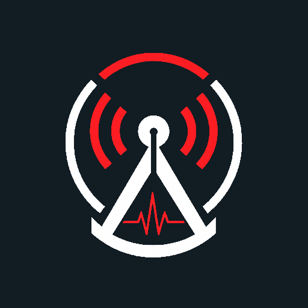
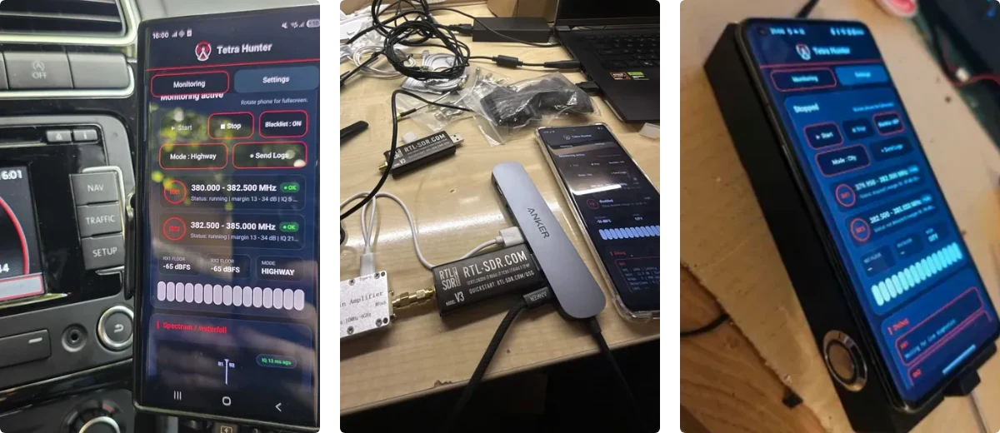
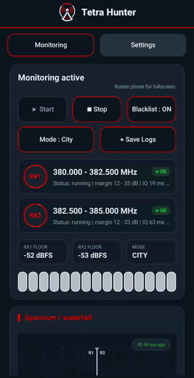
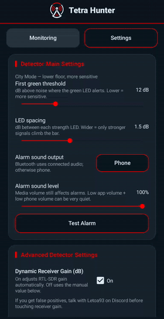

  

<h1 align="center">Tetra Hunter</h1>

<strong>The premium TETRA detector for Android. Know when police, ambulances and fire trucks are nearby, before you hear the sirens.</strong>

Trusted every day by 60+ drivers · 400+ members on Discord · Proven on real roads

  <a href="https://www.tetrahunter.eu/">Website</a> &nbsp;·&nbsp;
  <a href="https://www.tetrahunter.eu/setup/">Setup guide</a> &nbsp;·&nbsp;
  <a href="https://www.tetrahunter.eu/members-footage/">Real-road videos</a> &nbsp;·&nbsp;
  <a href="https://www.tetrahunter.eu/pricing/">Plans</a>

  

Real DIY setups shared by our members. The app and radio hardware in everyday use.

## Why Tetra Hunter

Free apps that beep for nothing? Or only once the cop car is already next to you? Yeah, we know. That's exactly why Tetra Hunter exists.

- 🚗 **Plug in, press Start, drive.** A clear 15-light bar, loud beeps on your phone or car Bluetooth, City and Highway modes.
- 🎥 **Proof, not promises.** Our members post their setups and [real-road videos](https://www.tetrahunter.eu/members-footage/) from their own cars.
- 🔄 **Always getting better.** Updates land straight in the app.
- 💬 **A real crew behind it.** 400+ members on Discord, a step-by-step [setup guide](https://www.tetrahunter.eu/setup/) and email support.

## TETRA detection with Android and RTL-SDR

Connect an RTL-SDR (software-defined radio) kit to your phone. Tetra Hunter checks for nearby TETRA radio activity and gives you an audible alert and a coloured signal bar. It helps you notice ambulances, fire trucks and police vehicles, including unmarked cars.

- **Audible alerts** with different sounds for green, orange and red signals.
- **A clear signal bar** to see received signal strength at a glance.
- **Your own settings** for colours and alerts.
- **App updates and support** from the team and community.

**Hardware is required as well as the app.** Your phone alone is not a TETRA receiver. Detection depends on radio activity, your antenna and the surroundings. The signal bar is not a distance meter. The app detects radio presence; it does not play or decode voice conversations.

## Inside the app

  
  &nbsp;&nbsp;
  

Real screen recordings of the app. Left: Monitoring. Right: Settings.

## Get started

1. **Check your phone and get the kit.** The [setup guide](https://www.tetrahunter.eu/setup/) lists compatible hardware and Android requirements.
2. **Choose your licence.** Your download link and credentials arrive by email after confirmed payment. The radio kit is sold separately.
3. **Connect and activate.** Follow the guide, plug in your kit and enter the credentials from your email.

## Frequently asked questions

<strong>Is it a police scanner? Can I listen to police radio?</strong>

No. In most of Europe, police, ambulance and fire services use digital, encrypted radio, so a scanner hears nothing useful. Tetra Hunter does not listen: it alerts you when a compatible TETRA radio is transmitting near you. [Can you listen to police radio?](https://www.tetrahunter.eu/listen-to-police-radio/)

<strong>What hardware do I need?</strong>

An Android phone (Android 8 or newer) with USB OTG, two small RTL-SDR receivers (RTL-SDR V3C; the V4 and Nooelec V5 work too), an antenna, a splitter and a powered USB hub. [Full shopping list](https://www.tetrahunter.eu/setup/)

<strong>Does it detect unmarked police cars?</strong>

Yes, when they use a compatible radio that is transmitting. Short transmissions can happen even when nobody is speaking. A silent or incompatible radio cannot be detected. [How to spot an unmarked police car](https://www.tetrahunter.eu/spot-unmarked-police-car/)

<strong>Does it work with Waze or Google Maps open?</strong>

Yes. Turn on background mode and it keeps running in the background, even with the screen off.

<strong>Is there an iPhone version or a free APK?</strong>

Tetra Hunter runs on Android only. Got an iPhone? Many members keep a cheap second-hand Android phone in the car. There is no free APK: your download link and licence arrive by email after purchase, with one payment and no subscription. [See the plans](https://www.tetrahunter.eu/pricing/)

## Community and support

**60+ daily users · 400+ Discord members.** Ask questions, share your installation and follow the project.

  <a href="https://discord.gg/nZPvbwzSpk">&nbsp;Discord</a> 
  <a href="https://www.tiktok.com/@tetrahunter1">&nbsp;TikTok</a> 
  <a href="https://www.instagram.com/tetra.hunter/">&nbsp;Instagram</a> 
  <a href="https://github.com/tetra-hunter/tetra-hunter">&nbsp;GitHub</a> 
  <a href="https://www.rdforum.org/threads/153451/">&nbsp;RDForum</a>

Need help? Start with the [FAQ](https://www.tetrahunter.eu/faq/), join Discord or email **[support@tetrahunter.eu](mailto:support@tetrahunter.eu)**.

Using Tetra Hunter? A ⭐ on this repository helps other drivers find it.

## Guides and comparisons

- [TETRA detection with Android and RTL-SDR](TETRA-DETECTION-GUIDE.md): what an alert means and how to choose a setup.
- [RTL-SDR dongle guide: V4, V4L or V3](https://www.tetrahunter.eu/blog/rtl-sdr-dongle/): hardware choices and Android projects.
- [Hardware detector or Android setup?](https://www.tetrahunter.eu/blog/hardware-detector-or-android/): equipment, installation, costs and detection limits.
- [Police scanner UK: what can a radio scanner still hear?](https://www.tetrahunter.eu/blog/radio-scanner/): listening to radio versus detecting radio presence.

Comparing detectors and radio networks

If you are looking for a police detector, Tetra Hunter offers an Android-and-RTL-SDR setup. It detects compatible TETRA radio activity, not a vehicle's identity or which emergency service is transmitting. A silent or incompatible radio cannot be detected.

[Compare traditional hardware competitors, Tetra Hunter and driving apps](https://www.tetrahunter.eu/tetra-hunter-vs-competitors/). Equipment, features and costs vary by device.

Looking into Airwave, ASTRID or C2000? Read the [TETRA detection guide](TETRA-DETECTION-GUIDE.md) first: a network name alone does not establish compatibility.

---

This repository is the official product overview, not the application source code. Tetra Hunter is commercial, closed-source software. It is not an open-source TETRA demodulator or a voice-decoding project.

[English](https://www.tetrahunter.eu/) · [Français](https://www.tetrahunter.eu/fr/) · [Nederlands](https://www.tetrahunter.eu/nl/) · [Deutsch](https://www.tetrahunter.eu/de/)
