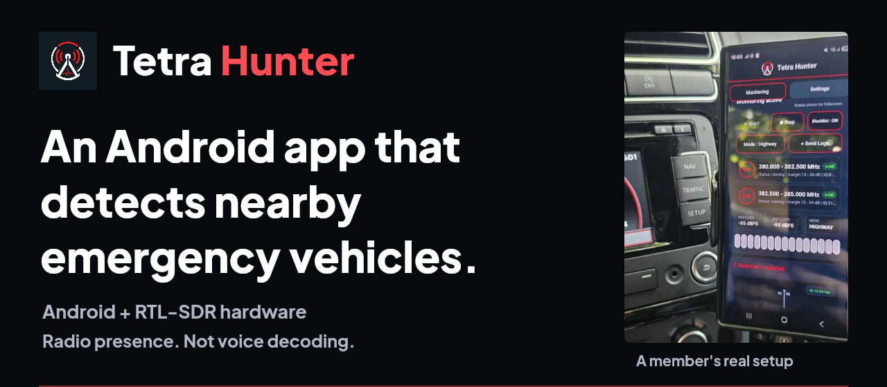
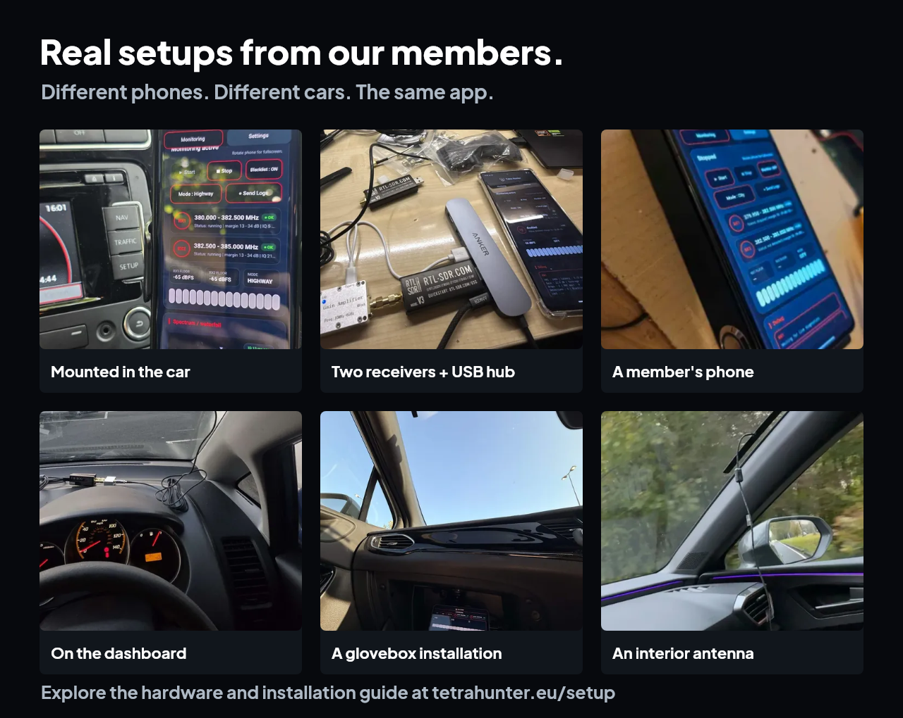
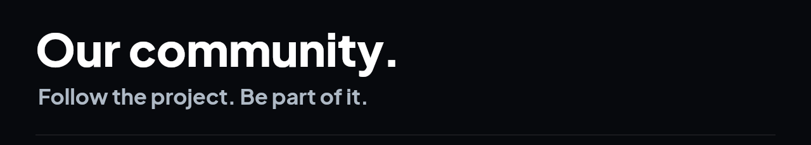
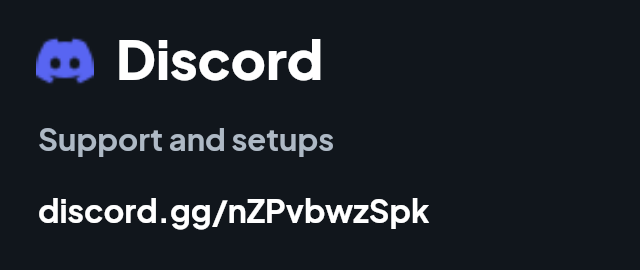
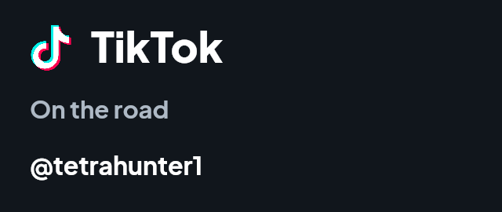
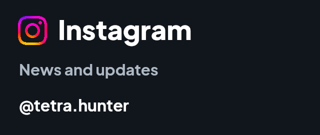
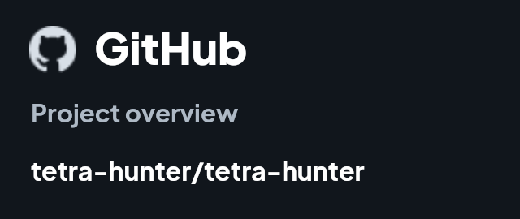
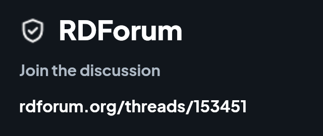
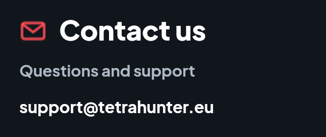

  <a href="https://www.tetrahunter.eu/"><b>Website</b></a> &nbsp; | &nbsp;
  <a href="https://www.tetrahunter.eu/setup/"><b>Setup guide</b></a> &nbsp; | &nbsp;
  <a href="https://discord.gg/nZPvbwzSpk"><b>Join our Discord</b></a>

# Tetra Hunter: RTL-SDR TETRA detector for Android

**An Android app that detects nearby emergency vehicles.**

Connect an RTL-SDR (software-defined radio) kit to your phone. Tetra Hunter checks for nearby TETRA radio activity and gives you an audible alert and a coloured signal bar. It helps you notice ambulances, fire trucks and police vehicles, including unmarked cars.

It detects radio presence. It does not play or decode voice conversations.

You need compatible USB radio hardware as well as the app. Your phone alone is not a TETRA receiver. Detection depends on radio activity, your antenna and the surroundings.

## Real DIY setups from our members

These are the same member photos featured on our website. Different phones, different cars, the same app.

[See the kit and more member setups](https://www.tetrahunter.eu/setup/) or [watch footage from our members](https://www.tetrahunter.eu/members-footage/).

**60+ daily users. 400+ Discord members.** Ask questions, share your installation and see how other people use it.

  
  

  
  

  
  

## Questions or setup help?

**New to SDR?** Read [TETRA detection with Android and RTL-SDR](TETRA-DETECTION-GUIDE.md): what an alert means, the hardware you need, and why presence detection is not voice decoding.

Start with the [FAQ](https://www.tetrahunter.eu/faq/) or the [setup guide](https://www.tetrahunter.eu/setup/). You can also join Discord or email **[support@tetrahunter.eu](mailto:support@tetrahunter.eu)**.

**Read the website in your language:** [English](https://www.tetrahunter.eu/) | [Français](https://www.tetrahunter.eu/fr/) | [Nederlands](https://www.tetrahunter.eu/nl/) | [Deutsch](https://www.tetrahunter.eu/de/)

<b>About the app, hardware and getting started</b>

## What you get

- **Alerts you can hear.** Different sounds for green, orange and red alerts.
- **A clear signal bar.** See the received signal strength at a glance.
- **Your own setup.** Choose your colours and adjust the alerts in the app.
- **Updates and help.** App updates included, with setup advice from the team and community.

## Getting started

1. **Check your phone and get the kit.** The [setup guide](https://www.tetrahunter.eu/setup/) lists the compatible hardware and Android requirements.
2. **Choose your licence.** The app download and your credentials arrive by email after confirmed payment. The radio kit is sold separately.
3. **Connect, activate and start monitoring.** Follow the guide, plug in your kit and enter the credentials from your email.

[View plans on the official website](https://www.tetrahunter.eu/pricing/)

## Looking for a Target Blu Eye alternative?

If you're comparing emergency vehicle detectors or looking for a police detector, Tetra Hunter offers an Android-and-RTL-SDR setup. It detects TETRA radio presence, not a vehicle's identity or which emergency service is transmitting.

[Compare Tetra Hunter and Target Blu Eye](https://www.tetrahunter.eu/tetra-hunter-vs-competitors/). Tetra Hunter is independent and is not affiliated with Target Blu Eye.

---

This repository is the official product overview, not the application source code. Tetra Hunter is commercial, closed-source software. It is not an open-source TETRA demodulator or a voice-decoding project.

Looking into Airwave, ASTRID or C2000? See our [TETRA detection guide](TETRA-DETECTION-GUIDE.md) before choosing a setup: a network name alone does not establish compatibility.

## More guides from our blog

- [RTL-SDR dongle guide: V4, V4L or V3](https://www.tetrahunter.eu/blog/rtl-sdr-dongle/) - Hardware choices, getting started and Android projects.
- [Target Blu Eye 2: price, models and an alternative](https://www.tetrahunter.eu/blog/target-blu-eye-alternative/) - Compare dedicated detectors with an Android-and-RTL-SDR setup.
- [Police scanner UK: what can a radio scanner still hear?](https://www.tetrahunter.eu/blog/radio-scanner/) - Understand the difference between listening to radio and detecting radio presence.
